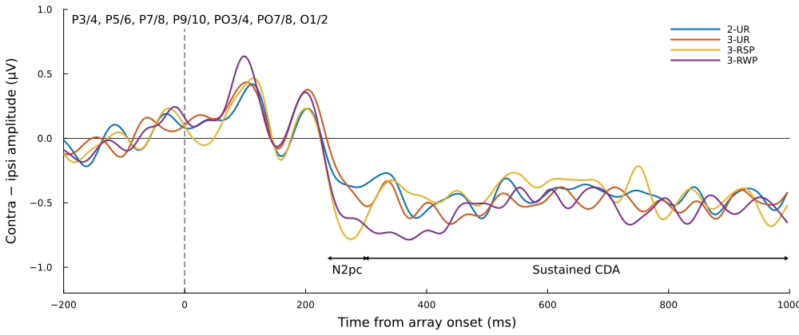
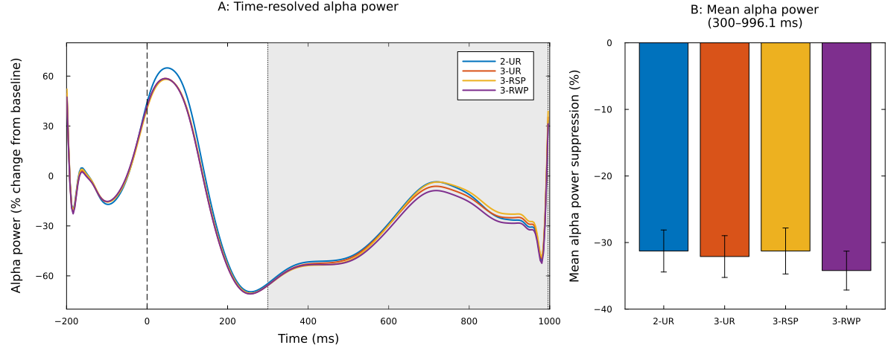
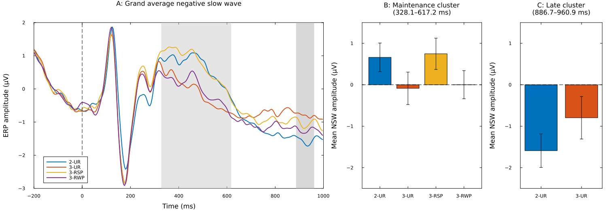

# Lateralized ERPs in visual working memory: a Julia reanalysis

A small, reproducible Julia pipeline that reanalyzes my open EEG dataset
[ds006979 on OpenNeuro](https://doi.org/10.18112/openneuro.ds006979.v1.1.0) (version 1.1.0)
(Ramzaoui & Beck, *Scientific Reports*, Registered Report; Stage 1 accepted, Stage 2 under review).

The study used a bilateral change-detection task to test how perceptual grouping by
color repetition affects stages of visual working memory. This repository computes two
lateralized ERP markers from the raw EEG:

- **N2pc**: individuation during encoding
- **CDA** (contralateral delay activity): maintenance and memory load

These are the **stimulus-locked** analyses (time-locked to the memory array). The
**probe-locked ERPs** of the original study (**N2pc, N2, FN400**) are **not reproduced** here.

Two exploratory analyses are also reproduced, on the non-lateralized average of the
14 posterior channels:

- **Alpha-power suppression**: 8–12 Hz Hilbert power, % change from the −200–0 ms baseline,
  averaged over 300–996.1 ms; Bayesian paired t-tests (BF01, Cauchy prior r = √2/2, computed in
  Julia exactly as `BayesFactor::ttestBF` in R), plus paired t-tests with Bonferroni correction
- **Negative slow wave (NSW)**: cluster-based permutation tests (10,000 sign flips) on
  paired difference waves, plus mean amplitudes in the cluster windows with Bayesian paired
  t-tests (BF10/BF01)

Measurement windows follow the paper: **N2pc 238.3–300 ms**, **sustained CDA 300–996.1 ms**,
and **early CDA 300–450 ms** (exploratory in the paper; it isolates the transition from item
selection to stable maintenance and is linked to encoding and filtering efficiency)
(final sample N = 39).

> This is an independent demonstration of the analysis in Julia. The confirmatory
> analysis is the one specified in the Stage 1 protocol
> ([OSF 8ZS96](https://doi.org/10.17605/OSF.IO/8ZS96)), run in MATLAB (EEGLAB/ERPLAB).

## Pipeline

The steps follow the original MATLAB/EEGLAB/ERPLAB scripts used for the registered analysis.

| MATLAB script | Step | Julia |
| --- | --- | --- |
| #0 | BDF import, channel selection, CleanLine (60 Hz), practice-trial removal, response recoding (participants 21, 22) | Already applied: the BIDS files are the Script #0 output, so preprocessing starts at Script #1 |
| #1 | Downsampling to 256 Hz; mastoid reference; bipolar HEOG (left − right) and VEOG (lower − Fp2); DC removal; 0.1 Hz high-pass (Butterworth, 12 dB/oct) | `resample`, `rereference!`, `add_bipolars!`, `remove_dc!`, `butter_filter!` |
| #2–#4 | ICA correction of blinks; interpolation of bad channels | **Original EEGLAB ICA weights** from the OpenNeuro derivatives and the removed components in `scripts/ICs_to_Remove.csv` (`read_ica_weights`, `apply_ica_weights!`). Interpolation not needed: no channel of interest was interpolated in the original analysis |
| #5 | Trials binned by condition from event codes; epochs −200 to 1000 ms; baseline −200 to 0 ms | `label_trials`, `epoch` |
| #6a | Blink and saccade step functions (VEOG, HEOG), extreme values, moving-window peak-to-peak | `art_step`, `art_extreme`, `art_mwpp` |
| #7a | Contra − ipsi waves averaged over P3/4, P5/6, P7/8, P9/10, PO7/8, PO3/4, O1/2; left-cue and right-cue trials averaged separately and combined 50/50, as in the ERPLAB bin operations (`nbin = 0.5*bin_left + 0.5*bin_right`); 20 Hz low-pass (48 dB/oct) on the averages | `cluster_contra_minus_ipsi`, `lowpass_epochs!` |
| #11a | Mean amplitudes (`meanbl`, baseline −200–0 ms) on the averages **without** the low-pass; window edges at the closest samples | `erplab_window`, `results/participant_means.csv` |
| #8a | HEOG difference waves to check residual eye movements | `results/heog_check.png` |
| Paper | One-way repeated-measures ANOVAs and pairwise comparisons on participant means (N2pc, early CDA 300–450 ms, sustained CDA); side-by-side comparison with the MATLAB values | `rm_anova`, `pairwise_pooled`, `results/paper_comparison.txt` |
| New | Single-trial mixed models; model-based effects | MixedModels.jl, [Effects.jl](https://github.com/beacon-biosignals/Effects.jl) |
| Alpha Steps 1–3 | ROI alpha power (8–12 Hz, mirror padding, Hilbert), % change, paired t-tests, exports for Bayesian tests | `alpha_power`, `src/ExploratoryStats.jl`, `scripts/04_…` |
| NSW Steps 1–4 | ROI slow wave; cluster permutation tests; window extraction and paired tests | `cluster_permutation`, `scripts/04_…` |

**Data source.** EEG was recorded with a BioSemi ActiveTwo system (64 scalp channels, 3 EOG,
2 mastoids; 512 Hz) and saved as BioSemi `.bdf` files. Script #0 imported the `.bdf` files in
EEGLAB (channel selection, CleanLine, practice-trial removal), and the cleaned recordings were
converted to BIDS with FieldTrip. The BIDS files therefore correspond to the Script #0
output (`N.set`), including the recoded responses for participants 21 and 22, and
preprocessing starts at Script #1, as in the original analysis. The BIDS release provides them as BrainVision files for every
participant (and also as EDF for sub-01). This repository reads the BrainVision files with a small
memory-mapped reader; `scripts/03_check_formats.jl` reads sub-01's EDF copy with
[EDF.jl](https://github.com/beacon-biosignals/EDF.jl) and confirms both formats give the same
signals (r = 1.000 on every channel; differences ≤ 0.55 µV, from EDF's 16-bit storage).

All settings (participants, filters, cluster, windows, artifact thresholds) are in `scripts/config.jl`.

## Get the data

Every participant has BrainVision files (`.vhdr`, `.vmrk`, `.eeg`, about 600–720 MB each);
sub-01 also has an EDF copy. `scripts/download_data.sh` downloads the 39 participants of the final
sample into `data/ds006979` (about 25 GB; files already downloaded are skipped, so it can be rerun
after an interruption):

```bash
bash scripts/download_data.sh
```

The ICA weights of the original analysis are in the dataset derivatives
(`derivatives/ReplicationPeterson2015/sub-XX/<id>_allERPs_optimized_weights.set`, where `<id>` is
the participant number without leading zero, e.g. `sub-01/1_allERPs_optimized_weights.set`).
Download them for the same 39 participants (about 105 MB each):

```bash
for s in 01 02 07 08 09 10 11 12 13 14 16 17 18 19 21 22 23 24 28 30 32 34 35 40 \
         47 48 49 50 51 54 58 59 61 62 64 69 70 73 76; do
  n=$((10#$s)); d=data/ds006979/derivatives/ReplicationPeterson2015/sub-$s; mkdir -p $d
  curl -sL -o "$d/${n}_allERPs_optimized_weights.set" \
    https://s3.amazonaws.com/openneuro.org/ds006979/derivatives/ReplicationPeterson2015/sub-$s/${n}_allERPs_optimized_weights.set
done
```

The components removed for each participant (`ICs_to_Remove.xlsx`, also in the derivatives) are
included here as `scripts/ICs_to_Remove.csv`.

Or download from the [OpenNeuro page](https://openneuro.org/datasets/ds006979).
To use a dataset stored elsewhere, set `DS006979=/path/to/ds006979` (and, if the ICA weights are
elsewhere too, `ICA_WEIGHTS=/path/to/ReplicationPeterson2015`).

## Run

Requires [Julia](https://julialang.org/downloads/) 1.10 or later.

```bash
julia --project=. scripts/00_setup.jl                 # install packages (once)
julia --project=. scripts/01_process_subjects.jl      # preprocessing → results/*.csv
julia --project=. scripts/02_statistics_and_figures.jl # models and figures
julia --project=. scripts/03_check_formats.jl          # EDF vs BrainVision check (sub-01)
julia --project=. scripts/04_exploratory_alpha_nsw.jl  # alpha power and negative slow wave
julia --project=. scripts/05_identify_alpha_filter.jl  # check the alpha filter against MATLAB (full comparison needs your alpha_power.mat)
```

## Outputs (`results/`)

| File | Contents |
| --- | --- |
| `qc.csv` | Binned (correct) trials, rejection rate per detector and overall, per participant |
| `trials.csv` | Every trial: labels, accuracy, one flag per artifact detector, kept or not, N2pc and CDA |
| `participant_means.csv`, `condition_summary.csv` | Participant-level mean amplitudes and condition summaries |
| `heog.csv`, `heog_check.png` | HEOG contra − ipsi waves (eye-movement check) |
| `rejection_rates.png` | Percentage of trials rejected per participant |
| `waveforms.csv` | Participant × condition average lateralized waveforms |
| `erp_anova.csv`, `erp_pairwise.csv` | Repeated-measures ANOVAs and pairwise comparisons (N2pc, early and sustained CDA), same method as the R analysis |
| `erp_pairwise_paired_t.csv` | The same comparisons as paired t-tests (Bonferroni and Holm), for reference |
| `paper_comparison.txt` | Julia results next to the MATLAB values |
| `models.txt` | Mixed-model summaries for CDA and N2pc |
| `cda_effects.csv`, `cda_effects.png` | Model-based CDA by condition (Effects.jl) |
| `grand_average.png`, `grand_average_early.png` | Grand-average contra − ipsi waveforms by condition, in the style of the paper's Figures 4 (N2pc and sustained CDA) and 3 (N2pc and early CDA, −200 to 500 ms) |
| `exploratory/` | Alpha and NSW tables (t-tests and Bayes factors), `alpha_paper_comparison.txt`, `nsw_paper_comparison.txt`, cluster results, figures, and paired-data CSVs for Bayesian t-tests in R |

## Figures

Grand-average contra − ipsi waves in the posterior cluster, with the N2pc and sustained CDA
windows (`results/grand_average.png`; the N2pc and early CDA version is `grand_average_early.png`):



Time-resolved alpha power (8–12 Hz, % change from baseline) and mean suppression in
300–996 ms (`results/exploratory/alpha_figure.png`):



Negative slow wave: grand averages with the MATLAB cluster windows, and mean amplitudes in
the primary maintenance and late set-size clusters (`results/exploratory/nsw_figure.png`):



## Validation against the MATLAB analysis (N = 39)

Applied to the BIDS data with the original ICA weights and removed components, the Julia
pipeline reproduces the MATLAB/ERPLAB + R analysis reported in the Stage 2 manuscript (correct
trials only). Julia keeps 31,964 trials (MATLAB: 31,954), condition
means are within 0.02 µV, every ANOVA gives the same conclusion, and every Bayes factor falls in
the same evidence category except one at the BF01 = 3 threshold. `results/paper_comparison.txt`
and `results/exploratory/*_paper_comparison.txt` print both side by side.

| Analysis | MATLAB | Julia | Reproduced |
| --- | --- | --- | --- |
| N2pc, ANOVA | F(3, 114) = 7.32, p < .001, ηp² = .16 | F(3, 114) = 7.07, p < .001, ηp² = .16 | Yes |
| N2pc, 3-RSP vs 2-UR | −0.33 µV, p = .001 | −0.33 µV, p = .001 | Yes |
| N2pc, 3-UR vs 3-RSP | 0.33 µV, p = .001 | 0.32 µV, p = .001 | Yes |
| N2pc, 3-RWP vs 2-UR | −0.24 µV, p = .037 | −0.24 µV, p = .045 | Yes |
| N2pc, 3-UR vs 3-RWP | 0.24 µV, p = .038 | 0.23 µV, p = .053 | Same difference; p at the .05 threshold |
| Early CDA, ANOVA | F(3, 114) = 5.27, p = .002, ηp² = .12 | F(3, 114) = 5.14, p = .002, ηp² = .12 | Yes |
| Early CDA, 3-RWP vs 2-UR and vs 3-RSP | −0.29 and −0.29 µV, p = .004 and .003 | −0.29 and −0.29 µV, p = .004 and .004 | Yes |
| Early CDA, 3-UR vs 3-RWP | p = .102 | 0.20 µV, p = .115 | Yes (not significant) |
| Sustained CDA, ANOVA | F(3, 114) = 0.86, p = .46, ηp² = .02 | F(3, 114) = 0.90, p = .44, ηp² = .02 | Yes (no effect) |
| NSW, grouping cluster (3-UR vs 3-RSP) | 328.1–617.2 ms, BF10 = 23,892 | 328.1–617.2 ms, BF10 = 20,090 | Yes |
| NSW, 3-UR vs 3-RWP | no cluster, BF01 = 5.22 | no cluster, BF01 = 5.40 | Yes |
| NSW, set size (2-UR vs 3-UR) | 402.3–605.5 ms, BF10 = 103 | 339.8–605.5 ms, BF10 = 163 | Yes |
| NSW, set size (2-UR vs 3-RWP) | 324.2–574.2 ms, BF10 = 27.9 | 324.2–558.6 ms, BF10 = 36.5 | Yes |
| NSW, late cluster (2-UR vs 3-UR) | 886.7–960.9 ms, BF10 = 5.09 | 886.7–960.9 ms, BF10 = 4.96 | Yes |
| NSW, 2-UR vs 3-RSP (a priori set-size window, 330–880 ms) | no cluster, BF01 = 2.99 | no cluster after 300 ms, BF01 = 3.51 | Same direction; at the threshold |
| Alpha, BF01 (2-UR vs 3-UR, 3-RSP, 3-RWP; 3-UR vs 3-RSP, 3-RWP) | 5.49, 5.79, 1.00, 5.27, 2.82 | 5.36, 5.79, 1.02, 5.12, 2.98 | Yes |

Window tests use the MATLAB cluster windows, so both pipelines test the same
intervals. The two values on either side of a threshold (N2pc 3-UR vs 3-RWP, p = .038 vs .053;
a priori-window NSW, BF01 = 2.99 vs 3.51) come from the small remaining numerical differences
(10 trials in total, and differences of about 0.01 µV in the participant means).

**sub-10 and sub-49.** In versions 1.0.0 and 1.0.1 of the dataset, the files of these two
participants were not the recordings the MATLAB analysis used: the events were incomplete (sub-10:
1,224 of 1,248 memory arrays; sub-49: 1,006 of 1,244), and sub-49 was stored at 2048 Hz. Since
version 1.1.0, they are the Script #0 recordings used in the analysis (`10.set`, `49.set`; 512 Hz,
practice trials removed), with complete events. `scripts/raw_events/` holds the same events
(1,248 and 1,244 memory arrays); script 01 reads them for these two participants, which gives the
same result as the events files of version 1.1.0. With the files of versions 1.0.x, the participant
means of these two participants differ by 0.2–0.4 µV and the 3-RWP N2pc comparisons are no
longer significant, so use version 1.1.0 or later.

Julia also finds short early NSW clusters (about 130–300 ms) in the comparisons with 2-UR. The
original analysis found them too but did not report them, because they reflect sensory
differences between two- and three-item displays rather than working memory load. The table
above lists only the clusters after 300 ms.

The recordings contain no boundary markers, and downsampling uses EEGLAB's own anti-aliasing
filter (`eeglab_resample`, identical to `pop_resample` on a MATLAB test signal), so neither is a
source of difference. Channel interpolation
is not a source of difference either: none of the 14 channels of interest was interpolated in the
original analysis.

## Notes and limitations

- **Probe-locked ERPs not reproduced.** The original study also analyzed ERPs time-locked to
  the probe (N2pc for initial comparison, N2 for percept-memory comparison, FN400 for decision
  and late comparison). This repository covers only the stimulus-locked analyses.
- **Blinks: the original ICA correction.** By default (`BLINK_CORRECTION = :ica_weights`) Julia
  applies the original ICA solution: the extended infomax weights saved by Script #3
  (`<id>_allERPs_optimized_weights.set`, in the dataset derivatives) and the blink components
  removed in Script #4 (`scripts/ICs_to_Remove.csv`: one for most participants, two for sub-40,
  none for sub-32). As in Script #4, the weights are applied to the 256 Hz, 0.1 Hz high-passed
  data referenced to the left mastoid, the components are removed as in `pop_subcomp`, and the
  data are then re-referenced to the average of the mastoids. Download the weights files into
  `data/ds006979/derivatives` (any subfolder), or set `ICA_WEIGHTS=/path/to/folder`.
- **Alternative: automated ICA** (`BLINK_CORRECTION = :fastica`), when the weights are not available:
  a training copy band-passed 1–30 Hz, resampled to 100 Hz, breaks removed (Script #2); FastICA
  with 30 components (Script #3); and removal of the same number of components per participant,
  chosen as those most correlated with the bipolar VEOG (Script #4). EOG channels stay uncorrected
  for artifact detection, and trials with a blink during stimulus presentation (−200 to 200 ms,
  50 µV) are still rejected, as in the original. `results/ica.csv` lists the removed components
  and their correlation with VEOG. The correction is close to, but not identical with, the
  original (different ICA algorithm, random initialization, no manual review).
  With `USE_ICA = false` in `config.jl`, blinks after 200 ms are instead rejected with the 30 µV
  threshold of Diaz, Vogel & Awh (2021).
- **Artifact parameters** come from the original ERPLAB spreadsheets: defaults in `config.jl`,
  per-participant thresholds in `scripts/artifact_overrides.csv`. The detectors follow the
  sample conventions of ERPLAB 10.02 (`pop_artstep`, `pop_artmwppth`, `window2sample`): window
  and step lengths are `floor(ms × fs / 1000)` samples (200 ms → 51, 10 ms → 2, 100 ms → 25),
  the first half of a step window has `round(51/2)` = 26 samples, period edges go to the sample at
  `round(t × fs)` (so −50 to 300 ms becomes −50.8 to 300.8 ms), and a trial is flagged when the
  value is strictly above the threshold. Applied to the ERPLAB HEOG of sub-02, these rules
  reproduce ERPLAB's saccade flags for all 1,190 trials.
- **Event codes:** codes 51–58 mark the memory array and 11–42 the probe, 1 s later (checked
  in the events files). Trials are time-locked to 51–58, as in `BDF_stimulus_correct.txt`.
- The 20 Hz low-pass is applied to each epoch, which gives exactly the same result as filtering
  the averaged ERPs (Script #7a), including at the epoch edges. As in Script #11a, it is used
  for the figures only; mean amplitudes are measured on the unfiltered
  averages.
- As in Script #1, all recordings are downsampled to 256 Hz on loading with EEGLAB's
  `pop_resample` filter (all recordings are at 512 Hz; in versions 1.0.x of the dataset, the file of sub-49 was at 2048 Hz).
- **Alpha band-pass: MATLAB's exact filter.** `bandpass(x, [8 12], 256)` designs the same filter
  for every signal of a given length (a 12th-order elliptic band-pass, 6 second-order sections).
  Its coefficients are in `scripts/matlab_bandpass_coeffs.csv`, and `matlab_filtfilt` applies them
  exactly as MATLAB's `filtfilt` does: section by section, each with a 36-sample odd extension at
  both ends and steady-state initial conditions. On a MATLAB test signal
  (`scripts/matlab_filtfilt_test.csv`) the two agree to about 1e-12 (checked by script 05).
  This matters because the filter rings for ~1.2 s, longer than the 0.5 s padding, so the edge
  handling shapes the whole alpha time course; DSP.jl's `filtfilt`, or the same filter with its
  sections in a different order, gives clearly different values. To export the coefficients again:
  ```matlab
  xt = randn(563, 1);                           % 563 = one padded trial at 256 Hz
  [~, d] = bandpass(xt, [8 12], 256);
  writematrix(d.Coefficients, 'matlab_bandpass_coeffs.csv', 'FileType', 'text');
  writematrix([xt, filtfilt(d, xt)], 'matlab_filtfilt_test.csv', 'FileType', 'text');
  ```
  Without the coefficients file, Julia falls back to its own elliptic design (`ALPHA_FILTER`).
- Alpha power: as in the MATLAB script, the Hilbert transform is applied after the 0.5 s padding is
  removed. This creates edge artifacts in the first and last ~50 ms of the epoch (in the baseline
  and the end of the 300–996.1 ms window). `ALPHA_HILBERT_PADDED = true` in `config.jl` applies the
  transform to the padded signal instead, as a sensitivity analysis.

## Data and citation

Data: Ramzaoui, H., & Beck, M. (2026). *Examining perceptual grouping on stages of
processing in visual working memory: An ERP study* [Dataset]. OpenNeuro, ds006979,
v1.1.0. https://doi.org/10.18112/openneuro.ds006979.v1.1.0 (CC0)

Code: MIT License.
